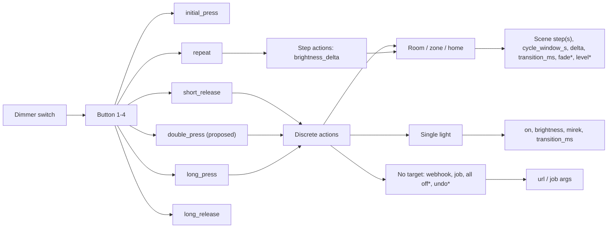
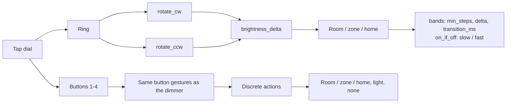
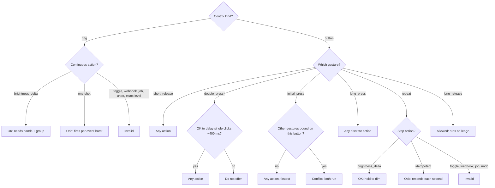
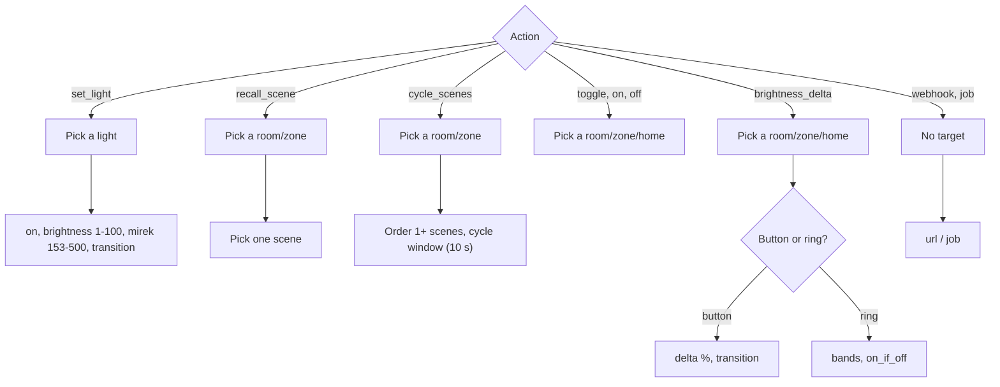

# What a switch can do: the full map

Written 2026-10-12 from the code and the dev database. It maps every combination of control,
gesture, action, target and setting, so the switch UI can be designed against the whole space.

Labels used throughout:

- **code**: exists in the code today (file cited).
- **proposed**: from design work, not in the code.
- **suggestion**: not in the code or the design list; raised by this map, take or leave.

Nothing acts on bindings yet. `control_bindings` is seeded from the bridge's v1 rules and presses are
logged to `control_events`, but no dispatcher reads the bindings (docs/DB_DESIGN.md, "Status"). So "in
code" below means "modelled and validated", not "carried out".

## 1. Summary

A binding is one row: **control × gesture → action → target + settings** (app/models/control_binding.rb).
Modifiers (proposed) would multiply that by conditions such as time of day.

| Axis | In code | Including proposed |
|---|---|---|
| Physical controls in the house | 13 (2 dimmers × 4 buttons, dial 4 buttons + 1 ring) | 13 |
| Gestures | 7 (5 button, 2 ring) | 8 (+ double press) |
| Actions | 9 | 13 (+ turn off everything, undo, full brightness, exact level) |
| Bindable slots (control × gesture that can physically fire) | 62 (12 × 5 + 1 × 2) | 74 (12 × 6 + 1 × 2) |
| Slots used today | 20 | 20 |
| Gesture × action combinations (the matrix) | 63 (7 × 9) | 104 (8 × 13) |
| ...of which make sense ✅ | 28 | 52 |
| ...allowed but odd ⚠ | 26 | 38 |
| ...invalid or conflicting ❌ | 9 | 14 |
| Modifiers | 0 | 2 (time of day, "if the room is off") |

How I counted:

- Gesture × action: button gestures × actions, plus ring gestures × actions. A ring gesture on a
  button (or the reverse) can never fire and is not counted. The ✅/⚠/❌ split is the matrix in
  section 3.
- Slots: each gesture is counted once per control it can physically come from.
- Targets and settings are not multiplied in, because settings are continuous (any delta, any
  level). With today's house the discrete (action, target) choices per slot are: 5 group actions ×
  6 groups (4 rooms, 1 zone, home) = 30, plus `set_light` × 14 lights, plus `recall_scene` × 28
  recallable scenes, plus `webhook` and `job` = **74**, before scene lists and settings.

## 2. The axes

### 2.1 Devices and controls

Source: `Hue::Device`, `Hue::Control` (app/models/hue/control.rb), dev database.

| Device | Product | v1 sensor | Controls | Kind |
|---|---|---|---|---|
| Living room lamp switch | Hue dimmer switch (RWL022) | /sensors/4 | buttons 1-4 (1 power, 2 brighter, 3 dimmer, 4 hue) | `button` |
| Bathroom switch | Hue dimmer switch (RWL022) | /sensors/13 | buttons 1-4 (same layout) | `button` |
| Hue tap dial switch 1 | Hue tap dial switch | /sensors/17 (ring), /sensors/18 (buttons) | buttons 1-4, ring | `button` × 4, `rotary` × 1 |

A control is a `button` (with `control_number` 1-4) or a `rotary` (no number). Unique on
`(device_id, kind, control_number)`.

### 2.2 Gestures

Source: `ControlBinding::GESTURES`, docs/HUE_NOTES.md, `control_events` in the dev database.

| Gesture | Control | Status | What happens physically |
|---|---|---|---|
| `initial_press` | button | code | The moment the button goes down. Fires for **every** press, short or long, before the bridge knows which it is. |
| `short_release` | button | code | Released before the hold threshold. The normal "click". Arrives ~0.3-1 s after `initial_press`. |
| `long_press` | button | code | Fires once when the button has been held past the threshold (about 1 s in the logs). |
| `repeat` | button | code | Fires again and again while still held, about once a second after `long_press` (logs: 07:17:39 long_press, repeat, 07:17:40 repeat). |
| `long_release` | button | code | Released after a hold. Fires once. |
| `double_press` | button | **proposed** | Two `short_release`s within ~400 ms, detected by the app (the bridge has no such event). |
| `rotate_cw` | ring | code | A `relative_rotary` event turning clockwise, with `steps` and `duration` (logs: 15-121 steps per 400 ms event). |
| `rotate_ccw` | ring | code | Same, counter-clockwise (app/services/hue/api/payloads/relative_rotary.rb). |

A short click sends `initial_press` → `short_release`. A hold sends `initial_press` → `long_press` →
`repeat`… → `long_release`. Turning the ring sends a burst of `rotate_*` events.

### 2.3 Actions

Source: `ControlBinding::ACTIONS` and docs/DB_DESIGN.md. "Carried out by" names the house command
that would do the work (app/services/house_commands/*).

| Action | Status | What it does | Carried out by |
|---|---|---|---|
| `recall_scene` | code | Recall one scene ("show a scene") | `SceneRecall` (Hue scene) / `CustomSceneRecall` (custom scene) |
| `cycle_scenes` | code | Next scene in a list each press; back to the first after the cycle window | same, plus `CycleState#advance!` |
| `toggle_group` | code | Off if any light in the room is on, otherwise on (v1 rules 1 and 2 used `any_on`) | `RoomSwitch` |
| `group_on` | code | Room on (last state) | `RoomSwitch(on: true)` |
| `group_off` | code | Room off | `RoomSwitch(on: false)` |
| `brightness_delta` | code | Brighter/dimmer by a step | none yet; `RoomBrightness` sets an absolute level only |
| `set_light` | code | One light to on/off, brightness, white temperature | `LightUpdate` |
| `webhook` | code (name only) | Call a URL | none |
| `job` | code (name only) | Run an app job | none |
| turn off everything that's on | **proposed** | All lit lights off | `RoomSwitch` on the home group |
| put it back how it was (undo) | **proposed** | Restore the state before the last change | none; needs a "before" snapshot per change |
| full brightness | **proposed** | Room to 100% | `RoomBrightness(group, 100)` |
| brightness to an exact level | **proposed** | Room to N% (as well as by a step) | `RoomBrightness(group, n)` |

"Show a scene" (single recall) is already `recall_scene`; the proposal is only about naming it in the UI.

### 2.4 Targets per action

Source: `ControlBinding::TARGETED_ACTIONS`, `#target_suits_action`. Groups in the house: rooms
Bathroom, Living room lamps, Kitchen, Mud pit; zone "Tap dail lights?"; home group "Home" (all 14
lights).

| Action | Target type | Required? | Allowed targets today | Notes |
|---|---|---|---|---|
| `recall_scene`, `cycle_scenes` | `Hue::Group` | yes | room, zone, home | the scenes live in `control_binding_steps`, not the target |
| `toggle_group`, `group_on`, `group_off`, `brightness_delta` | `Hue::Group` | yes | room, zone, home | home = whole house |
| `set_light` | `Hue::Light` | yes | 14 lights | error `must_be_light` otherwise |
| `webhook`, `job` | none | no | none | if one is given it must be a group, or `must_be_group` fires (quirk) |
| turn off everything (proposed) | none, or implicitly home | | | |
| undo (proposed) | none (last change), or a group | | | open question 6.4 |
| full brightness, exact level (proposed) | `Hue::Group` (or a light) | | | |

### 2.5 Settings per action

`settings` is free JSON; nothing validates its shape. Keys below are the ones the importer writes
(app/services/legacy_rules_import/*) or docs/DB_DESIGN.md names.

| Action | Setting | Range / options | Status | Today's values |
|---|---|---|---|---|
| `recall_scene` | one step (`Scene` or `CustomScene`) | any scene; should be the target group's | code (steps table) | none imported |
| `recall_scene` | recall mode `active` / `dynamic_palette` | 2 options (Hue::Api::SceneRecall) | suggestion | |
| `cycle_scenes` | ordered steps | 1+ scenes; `scene_type` is polymorphic so `CustomScene` is allowed by the schema | code (Hue scenes), **proposed** (custom scenes: no executor) | 5, 6 and 8 scene lists |
| `cycle_scenes` | `cycle_window_s` | seconds idle before going back to the first scene; default 10 | code | 10 |
| `brightness_delta` (button) | `delta` | signed % of full, -100..100 | code | ±11.8 (press), ±22.0 (hold) |
| `brightness_delta` (button) | `transition_ms` | ms, 0+ | code | 900 |
| `brightness_delta` (ring) | `bands` | list of `{min_steps, delta, transition_ms}`; faster turn → bigger delta | code | 6 bands: 2.4 → 100% |
| `brightness_delta` (ring) | `on_if_off` | `{slow: {brightness, min_steps, transition_ms}, fast: {...}}` | code | slow 1.6%, fast (≥127 steps) 50% |
| `brightness_delta` (button) | if the room is off, turn on at N% | 1-100 | **proposed** | v1 rules did this (`"on": true`); the importer dropped it |
| `set_light` | `on` | true / false | code | true |
| `set_light` | `brightness` | 0-100 (lit 1-100, `Hue::Api::Limits`) | code | 96.9, 0.4 |
| `set_light` | `mirek` | 153-500 | code | 182 |
| `set_light` | colour (`x`,`y` or hex) | CIE 0-1 | suggestion (`LightUpdate` supports it; no binding key) | |
| `set_light` | `transition_ms` | ms | code | none |
| `webhook` | `url` | | code (DB_DESIGN example only) | |
| `job` | job name/args | | undefined | |
| exact level | `level` | 1-100 | **proposed** | |
| all actions | fade | instant (0) / quick (100 ms) / smooth (~400 ms+) | **proposed** | `HouseCommands::Command::QUICK_FADE` is 100 ms; custom scenes default 400 ms |

Note `brightness_delta` has two settings shapes (button `delta`, ring `bands`) under one action name.

### 2.6 Modifiers (all proposed)

| Modifier | Shape | Applies to | Notes |
|---|---|---|---|
| Depends on the time of day | list of `{from, to, action, target, settings}` windows | any binding | changes the binding from one action to one action per window |
| If the room is off, turn it on at N% | `{on_if_off: N}` | brightness actions, scene cycling | the ring already has this (`on_if_off`); v1 rules 30, 31, 33 had variants |

## 3. The permutation matrix

✅ makes sense · ⚠ allowed but odd · ❌ invalid or conflicting · *P* = proposed.
Nothing in the code rejects ⚠ or ❌ cells today except where noted; the only validations are
gesture/action names, the unique `(control_id, gesture)` index, target presence and light-vs-group.

### 3.1 Buttons

| Gesture ↓ / Action → | recall | cycle | toggle | on | off | bri Δ | set_light | webhook | job | *all off* | *undo* | *full* | *level* |
|---|---|---|---|---|---|---|---|---|---|---|---|---|---|
| `initial_press` | ✅¹ | ✅¹ | ✅¹ | ✅¹ | ✅¹ | ✅¹ | ✅¹ | ✅¹ | ✅¹ | ✅¹ | ✅¹ | ✅¹ | ✅¹ |
| `short_release` | ✅ | ✅ | ✅ | ✅ | ✅ | ✅ | ✅ | ✅ | ✅ | ✅ | ✅ | ✅ | ✅ |
| *`double_press`* | ✅² | ✅² | ✅² | ✅² | ✅² | ⚠³ | ✅² | ✅² | ✅² | ✅² | ✅² | ✅² | ✅² |
| `long_press` | ✅ | ⚠⁴ | ✅ | ✅ | ✅ | ⚠⁵ | ✅ | ✅ | ✅ | ✅ | ✅ | ✅ | ✅ |
| `repeat` | ⚠⁶ | ⚠⁷ | ❌⁸ | ⚠⁶ | ⚠⁶ | ✅ | ⚠⁶ | ❌⁹ | ❌⁹ | ⚠⁶ | ❌¹⁰ | ⚠⁶ | ⚠⁶ |
| `long_release` | ⚠¹¹ | ⚠¹¹ | ⚠¹¹ | ⚠¹¹ | ⚠¹¹ | ⚠¹¹ | ⚠¹¹ | ⚠¹¹ | ⚠¹¹ | ⚠¹¹ | ⚠¹¹ | ⚠¹¹ | ⚠¹¹ |

### 3.2 Ring (each direction)

| Gesture ↓ / Action → | recall | cycle | toggle | on | off | bri Δ | set_light | webhook | job | *all off* | *undo* | *full* | *level* |
|---|---|---|---|---|---|---|---|---|---|---|---|---|---|
| `rotate_cw` / `rotate_ccw` | ⚠¹² | ⚠¹³ | ❌⁸ | ⚠¹² | ⚠¹² | ✅ | ⚠¹² | ❌⁹ | ❌⁹ | ⚠¹² | ❌¹⁰ | ⚠¹² | ❌¹⁴ |

A button gesture bound to the ring, or `rotate_*` bound to a button, can never fire. **The model
does not check this** (no validation ties gesture to `Hue::Control#kind`).

### 3.3 Reasons

1. `initial_press` is fine only if it is the button's **only** press-side binding. It fires at the
   start of every short click, every hold and both halves of a double press, so with any other
   gesture bound on the same button both actions run. Upside: fastest response (no wait for release).
2. Double press **delays every single click on that button** by the ~400 ms detection window, because
   the app must wait to see if a second click comes. Only buttons with a double-press binding should
   pay this. It also needs sub-second timing, see 6.6.
3. Double press for "two steps brighter" is legal but the user could just click twice.
4. Cycling on a hold advances one scene per hold, and the hold takes ~1 s. Slow; short click is better.
5. One step on hold, then nothing while held. Use `repeat` for hold-to-dim (the importer does this:
   `ButtonImporter#dimming_gesture`).
6. `repeat` fires about once a second while held. Idempotent actions (on, off, recall, a fixed
   level) just resend the same command, which wastes the ~1 group command/s budget. Harmless but pointless.
7. Cycling on `repeat` is "hold to browse scenes", one per second. Plausible but unusual; the cycle
   window resets cleanly afterwards.
8. Toggle on a repeating or continuous event flickers the room on/off.
9. Webhooks and jobs would fire many times per hold or turn.
10. Undo on a repeating event undoes, then undoes the undo.
11. `long_release` runs only when you let go after a hold, so there is no feedback while holding. It
    is valid, and the natural partner for a hold that already does something via `long_press` or
    `repeat` (e.g. "stop dimming"), but surprising as the only hold action. Also note: a hold fires
    `long_press` **and** `long_release`, so binding both gives two actions per hold.
12. The ring sends bursts of events (one per ~400 ms while turning). One-shot actions fire once per
    event, so a single turn triggers them several times. Workable only with a "first event of a
    turn" rule the app does not have. Clockwise = on, counter-clockwise = off is the most defensible.
13. Turning to browse scenes needs a step threshold (e.g. one scene per N steps), otherwise a fast
    turn skips several scenes at once.
14. An absolute level from a relative ring is meaningless (every turn sets the same level).

### 3.4 Conflicts between bindings on the same button

| Combination on one button | What happens | Status |
|---|---|---|
| `short_release` + `long_press` | Clean split: a click does one, a hold the other. This is what the importer produces. | ✅ |
| `initial_press` + anything else | `initial_press` runs on every interaction, plus the other action. | ❌ |
| `long_press` + `repeat` | Both fire on a hold; `long_press` then `repeat`s ~1 s apart. OK if `repeat` is a step and `long_press` is the first step. | ⚠ |
| `long_press` + `long_release` | Two actions per hold. | ⚠ |
| `short_release` + `double_press` (*P*) | Single click delayed ~400 ms. A double click must not also run the single action. | ⚠ (design cost) |
| Same gesture twice | Impossible: unique index `(control_id, gesture)` and `validates :gesture, uniqueness`. | ❌ by design |

### 3.5 Action needs, enforced or not

| Need | Enforced? | Where |
|---|---|---|
| `set_light` needs a light | yes | `ControlBinding#target_suits_action` |
| group actions need a room/zone/home | yes | same |
| targeted actions need a target | yes | `validates :target, presence: true, if: :targeted?` |
| `cycle_scenes` needs at least one scene | **no** (`CycleState#advance!` just returns nil on an empty list) | app/models/cycle_state.rb |
| `recall_scene` needs exactly one scene | **no** | |
| scenes belong to the target group | **no** | |
| `delta` / `bands` present for `brightness_delta` | **no** | |
| gesture matches control kind | **no** | |
| `webhook` needs a `url` | **no** | |

## 4. Diagrams

### 4.1 Control → gesture → action → target → settings: dimmer switch

`*` = proposed. `initial_press` and `long_release` lead to the same actions as `short_release` with
the caveats in 3.3.

### 4.2 Control → gesture → action → target → settings: tap dial

### 4.3 Decision tree: what can this control and gesture do?

### 4.4 Decision tree: what does the action need?

## 5. Per-device examples

Today = the imported bindings in the dev database (`bin/rails hue:import_v1_rules`). "Could also" lists
the ✅ options from section 3, and notes free slots.

### 5.1 Living room lamp switch (dimmer, target Living room lamps)

| Control | Gesture | Today | Could also |
|---|---|---|---|
| 1 (power) | short_release | `toggle_group` | on, off, recall, cycle, all off*, undo* |
| 1 | long_press | free | all off* (classic "leaving the house"), group_off, undo* |
| 1 | double_press* | (not possible yet) | full brightness*, recall a bright scene |
| 1 | initial_press, repeat, long_release | free | (avoid: conflicts or odd) |
| 2 (brighter) | short_release | `brightness_delta` +11.8%, 900 ms | exact level*, full* |
| 2 | repeat | `brightness_delta` +22.0%, 900 ms | (this is the right gesture for hold-to-brighten) |
| 2 | long_press | free | full brightness* |
| 3 (dimmer) | short_release | `brightness_delta` -11.8%, 900 ms | exact level* |
| 3 | repeat | `brightness_delta` -22.0%, 900 ms | |
| 3 | long_press | free | group_off, a nightlight scene |
| 4 (hue) | short_release | `cycle_scenes` Palm Beach > Tropical twilight > Relax > Nutcracker > Cancun > Fall harvest, 10 s window | recall one scene, cycle custom scenes* |
| 4 | long_press | free | undo*, time-of-day scene* |

### 5.2 Bathroom switch (dimmer, target Bathroom)

| Control | Gesture | Today | Could also |
|---|---|---|---|
| 1 (power) | short_release | `toggle_group` | time of day*: nightlight after 23:00 |
| 1 | long_press | free | all off* |
| 2 (brighter) | short_release | `brightness_delta` +11.8%, 900 ms | full* |
| 2 | repeat | `brightness_delta` +22.0%, 900 ms | |
| 3 (dimmer) | short_release | `brightness_delta` -11.8%, 900 ms | |
| 3 | repeat | `brightness_delta` -22.0%, 900 ms | |
| 4 (hue) | short_release | `cycle_scenes` Energize > Nightlight > Read > Relax > Rest, 10 s window | recall, custom scenes* |
| 4 | long_press | free | |
| all | initial_press, long_release, double_press* | free | |

Lost in import: v1 rule 30 turned the Bathroom on when the hue button was pressed with it off. The
cycle recall turns it on anyway, so the loss is probably harmless.

### 5.3 Hue tap dial switch 1

| Control | Gesture | Today | Could also |
|---|---|---|---|
| 1 | short_release | `cycle_scenes` on zone "Tap dail lights?": Cancun > Fall harvest > Nightlight > Nutcracker > Palm Beach > Relax > Sleepy > Tropical twilight, 10 s | recall, toggle |
| 1 | long_press | `group_off` zone | all off* |
| 2 | short_release | `cycle_scenes` on Living room lamps: Palm Beach > Relax > Tropical twilight > Nutcracker > Cancun > Fall harvest > Dimmed > Test, 10 s | |
| 2 | long_press | `group_off` Living room lamps | |
| 3 | short_release | `set_light` Fancy dinner table light: on, 96.9%, mirek 182 | exact level* on a room |
| 3 | long_press | `set_light` same light: on, 0.4% | |
| 4 | all | **free (button unused)** | anything; good home for all off*, undo*, time-of-day* |
| ring | rotate_cw | `brightness_delta` zone, 6 bands (+2.4% from 2 steps … +100% from 425 steps), on_if_off slow 1.6% / fast 50% | brightness on a different room |
| ring | rotate_ccw | `brightness_delta` zone, same bands negative (from 3 steps) | |

Lost in import: v1 rule 31 (button 1 turns the zone on if off; cycle covers it) and rule 33 (button 2
turns **Kitchen** on when Living room lamps is off; a cross-room conditional with no equivalent in
the model).

## 6. Edge cases and open questions

1. **One gesture, one action.** The unique index `(control_id, gesture)` makes a second binding for
   the same gesture impossible; the UI should edit the existing one, not add. Multi-step actions
   (v1 rule 33: cycle LR **and** turn Kitchen on) cannot be expressed. Is that acceptable?
2. **Target deleted on the bridge.** A full sync removes groups, lights and scenes the bridge no
   longer reports. Scene deletion destroys its `control_binding_steps` (`has_many :binding_steps,
   dependent: :destroy` in app/models/hue/scene.rb), so a cycle silently shrinks, possibly to zero
   steps. A deleted group or light leaves the binding's `target_id` dangling (no FK, polymorphic, no
   `dependent:` on the group/light side). The UI needs a "broken binding" state.
3. **Time windows (proposed).** Overlapping windows need a rule (first match? most specific?). Gaps
   need a default. Midnight wrap (22:00-06:00). DST days. Does a cycle's position reset when the
   window changes?
4. **Undo (proposed).** Undo what: the last change from this switch, this room, or the house? Across
   devices (dimmer dims, dial undoes)? Changes made outside the app (Hue app, schedules) are only seen
   as mirror updates, so "before" must be snapshotted from the mirror at command time. How many levels?
5. **Rate limits.** ~10 light commands/s and ~1 grouped_light command/s (docs/HUE_NOTES.md). The ring
   sends events every ~400 ms and `repeat` ~1/s, so ring dimming must coalesce deltas while a PUT is
   in flight (planned in DB_DESIGN.md "Rotary handling"). `RoomBrightness` PUTs each lit light
   separately, so a room of 8 lit lights is ~1 s of light budget per step. Custom scenes in a cycle
   are per-light PUTs unless pushed to the bridge.
6. **Double press timing (proposed).** `control_events.occurred_at` comes from the bridge's
   `creationtime`, which has 1-second resolution (all logged times end in .000). A 400 ms window must
   use the app's receive time, which includes network jitter.
7. **Ring units.** Imported `bands.min_steps` are v1 `expectedrotation` thresholds; v2 events report
   `steps` (logged 15-121 per event). Whether they are the same unit is unverified.
8. **Lost "turn on" behaviour.** The v1 brightness rules sent `"on": true` with `bri_inc`, so
   "brighter" on an off room turned it on. The importer keeps `delta` and `transition_ms` only. This
   is what the proposed "if the room is off, turn on at N%" would restore.
9. **Two brightness shapes.** Button `delta` vs ring `bands` + `on_if_off` under one action name.
   Should the UI expose bands at all, or a "sensitivity" slider that generates them?
10. **Scene/room mismatch.** Nothing stops a Living room scene in a Bathroom-targeted binding.
    Recalling a Hue scene affects its own lights regardless of target, so the target only matters for
    cycle reset and "on if off".
11. **Smart scenes** (1 in the house) are excluded from `Hue::Scene.recallable`; should they be
    pickable?
12. **Custom scenes across rooms** have no single group target, but group actions require one. Does a
    cross-room custom scene in a cycle target "home"?
13. **Cycle reset.** `CycleState` restarts at the first scene after `cycle_window_s` idle. Should
    "next press gives: Relax" be shown in the UI (DB_DESIGN says yes)? `cycle_states` is empty today.
14. **Handover from the bridge.** The bridge's v1 rules still act on every press. Until they are
    deleted, any app binding runs **in addition** to the bridge rule. The UI should say which
    switches the app owns.
15. **Disabled bindings.** `enabled: false` frees nothing (the slot stays taken by the unique index).
16. **`webhook`/`job`** have no settings schema or executor; decide whether to show them at all.
